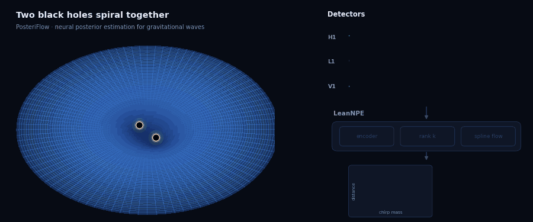

# PosteriFlow — Neural Posterior Estimation for Overlapping Gravitational-Wave Signals

[](https://python.org)
[](https://pytorch.org)
[](LICENSE)

> Amortized, calibration-audited posterior estimation for compact-binary
> coalescences in whitened 3-detector strain — seconds per event instead of
> minutes-to-hours, with per-signal posteriors for time-overlapping sources.

<p align="center">
  
</p>

## What it does

Classical parameter estimation (dynesty, bilby-MCMC) evaluates a waveform
likelihood hundreds of thousands of times per event and assumes **one signal
per segment**. As detectors improve, signals start to **overlap in time** and
that assumption breaks.

PosteriFlow trains **LeanNPE** on simulated `(signals + noise → parameters)`
examples so that one forward pass answers:

> *"Given 4 s of whitened H1/L1/V1 strain, what is the posterior over the 11
> parameters of the k-th loudest signal present?"*

Parameters (fixed order): `mass_1, mass_2, luminosity_distance, ra, dec,
theta_jn, psi, phase, geocent_time, a1, a2` (aligned spins, `mass_1 ≥ mass_2`).
Overlaps are handled by **rank conditioning**: query rank 0 for the loudest
signal, rank 1 for the next, and so on.

Models: one mixed BBH/NSBH/BNS model (`model/lean_npe_v3`) and one per source
class (`model/lean_npe_{bbh,nsbh,bns}_v3`), chosen with `infer.py --event-type`.

## How it works

Full architecture: [`architecture`](architecture).

```
whitened strain [3, 16384] ─► norm-free conv stem (asinh) ─► tokens per detector
  + geometry tokens       (cross-detector coherence, phase, arrival-time delays)
  + matched-filter tokens (complex overlaps with a fixed (Mc, q) template bank)
  + polarization tokens   (cross-detector amplitude ratio, relative phase, Δt)
        ─► 3-layer transformer ─► attention pooling
  + raw log-energy branch  (absolute amplitude = distance cue)
  + PSD branch             (detector sensitivity → physical SNR)
        ─► context (256) ⊕ rank embedding (32) ─► neural spline flow ─► posterior
```

Design rules that the code relies on:

- **No normalization on the amplitude path.** Strain is whitened, so absolute
  amplitude *is* the distance/SNR cue; a raw log-energy branch keeps it intact.
- **Rank conditioning** makes "predict every overlapping signal" a well-posed
  conditional. Signals are ordered by `Mc^(5/6)/d_L` everywhere.
- **Pure-NLL objective**, plus an optional small auxiliary mass regression on
  the encoder context (`--aux_mass`).
- **Fixed parameter scaling.** `ParamScaler` is a deterministic map to
  [−1, 1] (log for masses/distance); circular parameters wrap exactly. The
  production mass coordinates are chirp mass / mass ratio (`mc_q`).
- **The dataset matters more than the architecture.** Every event is stored as
  separate whitened components (noise, each signal) and `RemixDataset`
  assembles a fresh example every epoch: noise swap, real O3/O2 noise
  re-coloring, time shift, distance rescale, overlap summation, detector
  dropout and sky/delay remapping, with labels updated consistently.
- **Calibration-gated checkpoints.** Each epoch reports spurious railing,
  base-space concentration, high-SNR coverage and SBC; `best_model.pth` is the
  lowest-validation-NLL epoch that passes the calibration gate.

## Setup

```bash
conda activate ahsd     # Python 3.10: torch, bilby, gwpy, nflows
pip install -e .        # editable install of src/
```

Always run inside the `ahsd` env (`conda run -n ahsd python ...`). The
matched-filter template banks ship in `src/ahsd/models/assets/`; rebuild one
with `src/ahsd/models/build_mf_bank.py`.

## Usage

**Generate and audit a dataset** (parallel shards; long inspirals are generated
over a longer segment and cropped to the window):

```bash
conda run -n ahsd python src/ahsd/data/scripts/generate_parallel.py \
    --config configs/data_config_fixed.yaml --n-samples 200000 \
    --output-dir data/dataset_v3 --shards 32 --seed 2026
conda run -n ahsd python scripts/audit_dataset.py data/dataset_v3 --dist-range 8 6000
```

`data_config_fixed.yaml` is the mixed population;
`data_config_{bbh,nsbh,bns}_v3.yaml` are single-class. See
[`docs/DATASET_GENERATION.md`](docs/DATASET_GENERATION.md).

**Real-noise bank:**

```bash
conda run -n ahsd python scripts/download_gwosc_noise_bank.py --per_det 120 --outdir data/noise_bank
```

**Train** (BBH recipe; NSBH/BNS models drop the three MF/polarization flags):

```bash
conda run -n ahsd python -u experiments/train_lean_npe.py --data data/dataset_bbh_v3 --remix \
    --epochs 40 --batch 128 --lr 3e-4 --dist_range 80 5000 \
    --encoder_type coherent --mass_param mc_q --psd_cond \
    --mf_tokens --mf_bank mf_bank_bbh.npz --pol_features \
    --delay_aug 0.5 --aux_mass 1.0 --geom_dropout 0.25 \
    --noise_bank data/noise_bank --real_noise_prob 0.9 --det_dropout 0.2 \
    --ckpt_every 2 --outdir model/lean_npe_bbh_v3
```

On the SLURM cluster, `scripts/run_pipeline.py --regenerate` runs
generate → audit → train → certify → summary for all four models unattended.

**Read the per-epoch log:**

| Field | Healthy | If not |
|---|---|---|
| `shufΔ` | climbs several nats | near 0 = encoder ignored; diagnose, don't train longer |
| `dcorr` | lifts off 0 by epoch 10–15 | amplitude not being used |
| `rail` | ≤ ~0.06 | overconfident; epoch rejected for `best_model` |
| `zc` | ≈ 1.0 | > 1.5 = posteriors too narrow |
| `covHi` | ≈ 0.90 | high-SNR under-coverage |
| `val` vs `train` | fall together | val rising = memorization (a data problem) |
| `REAL …` | approaches the Gaussian block | raise `real_noise_prob` / bank size |

**Certify a checkpoint** (SBC, coverage, railing, real GWTC events of the
model's classes → HTML report):

```bash
conda run -n ahsd python scripts/validate_checkpoint.py --model model/lean_npe_bbh_v3/best_model.pth
```

Benchmarks: `scripts/benchmark_real_events.py` and `scripts/dynesty_compare.py`
(vs dynesty), `scripts/overlap_benchmark.py`, `scripts/twin_grid.py`,
`scripts/inclination_vs_dynesty.py`.

**Inference:**

```bash
conda run -n ahsd python infer.py --event GW150914 --samples 10000 --output results/GW150914
```

```python
import torch
from ahsd.inference.pipeline import load_model

model, meta = load_model("model/lean_npe_bbh_v3/best_model.pth", "cpu")
strain = torch.randn(1, 3, 16384)                     # whitened H1/L1/V1, 4 s @ 4096 Hz
post = model.sample_posterior(strain, rank=0, n_samples=3000)   # [1, 3000, 11], physical units
```

Production inference goes through `ahsd.inference.infer` / `infer.py`, which
add preprocessing, OOD/confidence gating, importance reweighting and a dynesty
fallback.

> When adding a `LeanNPE(**kw)` argument, thread it through every checkpoint
> load site (`grep -rn "LeanNPE(" src scripts experiments`), or older scripts
> will fail on new checkpoints.

## Project structure

```
src/ahsd/
├── models/       lean_npe.py (LeanNPE, ParamScaler), coherent_encoder.py,
│                 polarization_features.py, flows.py, build_mf_bank.py, assets/ (template banks)
├── data/         bilby-based generator: sampler, injector, whitening, PSDs
├── inference/    pipeline.infer(), preprocessing, OOD gating, importance, dynesty bridge
├── evaluation/   metrics, basin probe
└── core/         PriorityNet (optional reordering of overlap results)
experiments/      train_lean_npe.py, remix_data.py (RemixDataset), delay_aug.py
scripts/          certification, benchmarks, dataset audit, noise bank, cluster pipeline
configs/          dataset configs
notebooks/        small end-to-end walkthrough (data → training → results)
infer.py          inference CLI
```

## Roadmap

1. Inclination and polarization from the new cross-detector features —
   validated against dynesty on edge-on systems.
2. Larger real-noise bank across O1–O4.
3. Sharper chirp-mass posteriors for low-mass systems.
4. Pre-merger (early-warning) training (`--premerger`).
5. End-to-end overlap benchmark in real noise.

## References

- Dax et al., *DINGO — Real-Time GW Science with NPE*: [arXiv:2106.12594](https://arxiv.org/abs/2106.12594)
- Durkan et al., *Neural Spline Flows*: [arXiv:1906.04032](https://arxiv.org/abs/1906.04032)
- Ashton et al., *Bilby*: [arXiv:1811.02042](https://arxiv.org/abs/1811.02042)
- Talts et al., *Simulation-Based Calibration*: [arXiv:1804.06788](https://arxiv.org/abs/1804.06788)
- GWOSC open data: [gwosc.org](https://gwosc.org)

## License & citation

MIT — see [LICENSE](LICENSE). Citation metadata: [`CITATION.cff`](CITATION.cff) (GitHub "Cite this repository").

```bibtex
@software{thomas2026posteriflow,
  title  = {PosteriFlow: Calibrated Neural Posterior Estimation
            for Overlapping Gravitational-Wave Signals},
  author = {Thomas, Bibin},
  year   = {2026},
  url    = {https://github.com/bibinthomas123/PosteriFlow}
}
```

**Author:** Bibin Thomas — bibinthomas951@gmail.com
